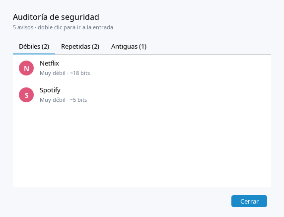
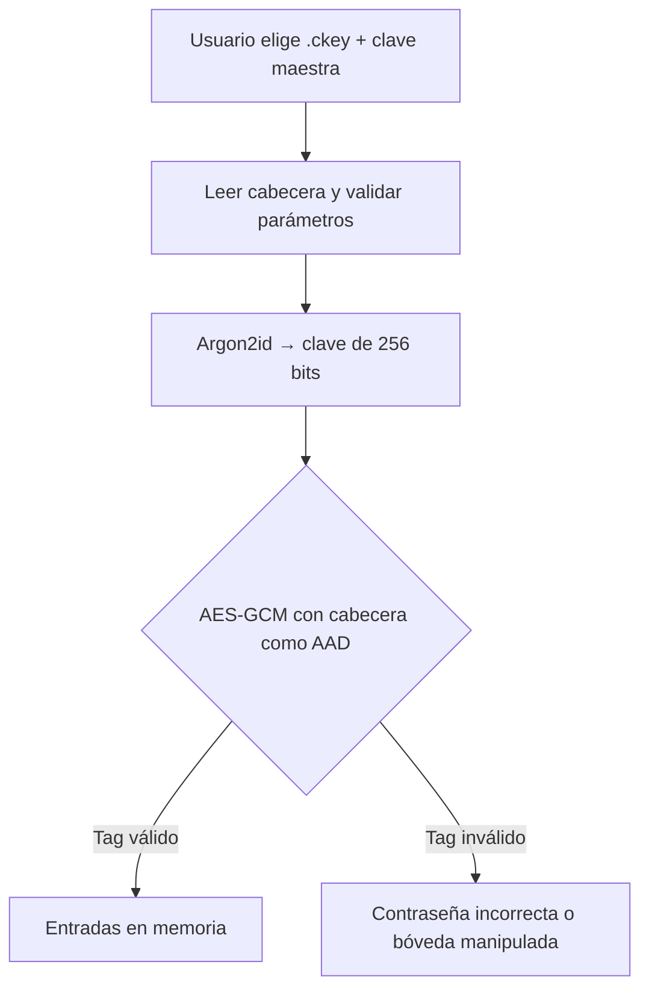

<p align="center">
  
</p>
<p align="center">
  <strong>Robusto • Simple • Seguro • 100% Offline</strong><br>
  Gestor de contraseñas cifrado desarrollado en Java
</p>

<p align="center">
  
  
  
  
  
</p>

---

# 📚 Índice

- [📌 Descripción](#-descripción)
- [✨ Características](#-características)
- [🛡️ Seguridad](#-seguridad)
- [🏗️ Arquitectura](#️-arquitectura)
- [📂 Estructura del Proyecto](#-estructura-del-proyecto)
- [🖥️ Manual de Usuario](#️-manual-de-usuario)
- [🚀 Instalación](#-instalación)
- [🧪 Tests](#-tests)
- [📊 Diagramas](#-diagramas)
- [🔄 Versionado](#-versionado)
- [🤝 Contribuir](#-contribuir)
- [📄 Licencia](#-licencia)

---

# 📌 Descripción

**CipherKey** es un gestor de contraseñas seguro, completamente offline, desarrollado en **Java (JDK 25)** utilizando **Java Swing** para la interfaz gráfica.

Su objetivo es proporcionar almacenamiento cifrado local sin depender nada ajeno al ordenador local.

### 🔒 *__Tu seguridad no debería depender de terceros.__*

---

# ✨ Características

- 🔐 Bóveda cifrada en un único archivo `.ckey` protegida con clave maestra
- 🗂️ Entradas con usuario, contraseña, sitio web, notas, **categorías** y **favoritas**
- 🔎 Búsqueda instantánea por nombre, usuario, sitio, categoría o notas
- 🔑 Generador de contraseñas (8-64 caracteres, sin caracteres ambiguos opcional) y medidor de fuerza
- 🌗 Tema claro y oscuro (se recuerda), interfaz moderna con FlatLaf y soporte HiDPI
- ⌨️ Atajos de teclado y menú contextual
- 🔢 **Códigos 2FA (TOTP)** por entrada, compatibles con Google Authenticator/Aegis, con cuenta atrás
- 🛡️ **Auditoría de seguridad**: contraseñas débiles, repetidas, antiguas o vacías
- 🕘 **Historial** de las últimas 10 contraseñas de cada entrada
- 📥 **Importar** CSV de Bitwarden, Chrome/Edge/Firefox y KeePass; 📤 exportar a CSV
- 💾 **Copia de seguridad** de la bóveda (sigue cifrada)
- 🧹 Portapapeles que se borra solo a los 30 s y bloqueo automático por inactividad (configurable)
- 🌐 100% offline

---

# 🛡️ Seguridad

| Característica | Implementación |
|---------------|---------------|
| Derivación de clave | Argon2id (64 MiB, 3 iteraciones, sal de 32 bytes); parámetros guardados en la cabecera |
| Cifrado | AES-256-GCM, nonce aleatorio nuevo en cada guardado |
| Integridad | La cabecera del fichero se autentica como AAD: cualquier alteración invalida la bóveda |
| Guardado | Atómico (fichero temporal + `fsync` + renombrado) con copia `.bak` de la versión anterior |
| Memoria | La contraseña maestra no se conserva tras abrir; solo la clave derivada, que se pone a cero al bloquear |
| Portapapeles | Se limpia a los 30 s si sigue conteniendo lo copiado |
| Bloqueo | Por inactividad (5 min) |

### 🔐 Decisiones de Seguridad

- No se almacenan contraseñas en texto plano y la clave maestra nunca se guarda.
- Sin conexión a red.
- Formato `.ckey` v2: `"CKEY" | versión | KDF | memoria | iteraciones | paralelismo | sal | nonce | cifrado+tag`.
- No es compatible con los `.ckey` de la v3.0 (eran bóvedas de prueba).
- El límite de intentos del login es solo de usabilidad: quien tenga el `.ckey` puede atacarlo offline, por eso la protección real es Argon2id + una clave maestra larga.
- Doble factor de la bóveda: pendiente (ver Hoja de ruta). La v3.0 lo hacía por email, pero no protegía el fichero y se ha eliminado. Los códigos TOTP de las entradas son otra cosa: sirven para tus cuentas, no para abrir CipherKey.

---

# 🏗️ Arquitectura

CipherKey sigue una arquitectura inspirada en el patrón **MVC (Model-View-Controller)** para separar responsabilidades.

| Capa | Responsabilidad |
|------|----------------|
| Model | Representación de datos (Credenciales, Usuario) |
| View | Interfaz Swing con FlatLaf (tema claro/oscuro, iconos SVG) |
| Controller | Lógica de la gestion de Contraseñas y bovedas |
| Security | Cifrado, persistencia y seguridad |
| Persistence | Formato `.ckey` (`Vault`) y preferencias de la aplicación |

---

# 📂 Estructura del Proyecto

```
src/
 └── main/
     └── java/dev/
                 ├── controller/
                 ├── model/
                 ├── persistence/
                 ├── security/
                 └── view/
```

### Justificación

- Separación clara de responsabilidades.
- Facilita escalabilidad.
- Permite testear la lógica sin depender de la UI.
- Mejora mantenibilidad.

---

# 🖥️ Manual de Usuario

## 1️⃣ Acceso

- Elige tu bóveda (las recientes aparecen en el desplegable) o pulsa **Examinar…**, escribe la clave maestra y **Desbloquear**.
- **Crear una bóveda nueva** pide una clave de al menos 8 caracteres con medidor de fuerza. Ojo: si la olvidas, no hay recuperación.

<p align="center">
  
  
</p>

## 2️⃣ Ventana principal

- **Barra lateral:** todas las entradas, favoritas y categorías (con recuento).
- **Lista:** ordenable por columna; doble clic o `Enter` para editar.
- **Panel de detalle:** contraseña oculta con mostrar/copiar, abrir el sitio web, notas y fechas.

<p align="center">
  
</p>
<p align="center">
  
</p>

| Atajo | Acción |
|-------|--------|
| `Ctrl+N` | Nueva entrada |
| `Ctrl+F` | Buscar |
| `Ctrl+B` / `Ctrl+U` | Copiar contraseña / usuario |
| `Ctrl+E` | Editar |
| `Supr` | Eliminar (con la lista enfocada) |
| `Ctrl+L` | Bloquear |

## 3️⃣ Entradas, 2FA y generador

- En una entrada puedes pegar la clave 2FA (secreto base32 o el enlace `otpauth://` del QR) y verás el código de 6 dígitos con cuenta atrás en el panel de detalle.
- Si cambias la contraseña, la anterior pasa al **Historial** (máx. 10).

<p align="center">
  
  
</p>

## 4️⃣ Auditoría, importación y copias

- **Auditoría** (barra lateral): lista las entradas con contraseñas débiles, repetidas, sin cambiar en más de un año o vacías; doble clic para ir a la entrada.
- **⋯ → Importar desde CSV**: reconoce Bitwarden, Chrome/Edge/Firefox y KeePass por los nombres de columna y omite duplicados. Borra el CSV después: contiene contraseñas sin cifrar.
- **⋯ → Exportar a CSV**: formato Bitwarden; avisa antes de escribir contraseñas en claro.
- **⋯ → Copia de seguridad**: copia el `.ckey` (cifrado) donde elijas.

<p align="center">
  
</p>

---

# 🚀 Instalación

Descarga la última versión desde **[Releases](../../releases/latest)**. Los paquetes **incluyen su propio Java**: no necesitas instalar nada más.

| Sistema | Archivo | Cómo usarlo |
|---------|---------|-------------|
| 🐧 Debian / Ubuntu | `cipherkey_<versión>_amd64.deb` | `sudo apt install ./cipherkey_*.deb` y búscalo en el menú de aplicaciones |
| 🐧 Cualquier Linux | `CipherKey-<versión>-linux-x64.tar.gz` | `tar xzf` y ejecuta `CipherKey/bin/CipherKey` |
| 🪟 Windows | `CipherKey-<versión>.msi` o `…-windows-x64.zip` (portable) | Instala el `.msi`, o descomprime el zip y ejecuta `CipherKey.exe` |
| 🍎 macOS (Apple Silicon) | `CipherKey-<versión>.dmg` | Arrastra la app a Aplicaciones |
| ☕ Cualquiera con Java 25 | `cipherkey-<versión>.jar` | `java -jar cipherkey-<versión>.jar` |

Cada release incluye `SHA256SUMS.txt` para verificar la descarga (`sha256sum -c SHA256SUMS.txt`).

> ⚠️ Los instaladores **no están firmados**. Windows mostrará SmartScreen ("Más información → Ejecutar de todas formas") y macOS pedirá abrirla con clic derecho → Abrir la primera vez.

## 🔧 Compilar desde el código

Requisitos: JDK 25 y Maven 3.9+.

```bash
git clone https://github.com/AdriLabTech/CipherKeyV2.git
cd CipherKeyV2
mvn clean package            # genera target/cipherkey-<versión>.jar
java -jar target/cipherkey-*.jar
```

Para crear un paquete nativo (cada tipo solo se puede construir en su propio sistema operativo):

```bash
packaging/package.sh app-image   # carpeta portable, cualquier SO
packaging/package.sh deb         # Linux (requiere dpkg-deb/fakeroot)
packaging/package.sh msi         # Windows (requiere WiX Toolset)
packaging/package.sh dmg         # macOS
```

## 🏷️ Publicar una versión

1. Sube la versión en `pom.xml` (p. ej. `4.1.0`) y haz commit.
2. `git tag v4.1.0 && git push origin v4.1.0`
3. GitHub Actions construye los paquetes de Linux, Windows y macOS y crea la release. La etiqueta debe coincidir con la versión del `pom.xml` o el workflow falla.

## 🆕 Primera ejecución

- Pulsa **Crear una bóveda nueva**, elige dónde guardar el `.ckey` y define tu clave maestra.

---

# 🧪 Tests

```bash
mvn test
```

Cubren el formato y la criptografía de la bóveda (contraseña incorrecta, manipulación de cabecera y datos, cambio de clave, guardado atómico, parámetros KDF absurdos) y el generador de contraseñas.

---

# 📊 Diagramas

## 🔷 Apertura de bóveda



---

# 🔄 Versionado

El proyecto sigue.

## V[Beta]

### Añadido
- Sistema de autenticación con clave maestra
- Persistencia cifrada `.ckey`
- Interfaz gráfica Swing

## V[1.0]

### Añadido
- Sistema de autenticación con clave maestra
- Generador de contraseñas
- Persistencia cifrada `.ckey`
- Interfaz gráfica Swing

  ## V[2.0]

### Añadido
- Sistema de autenticación con clave maestra
- Generador de contraseñas
- Persistencia cifrada `.ckey`
- Interfaz gráfica Swing
- Gestion de Bovedas
- Modo oscuro

## V[3.0]

### Añadido
- Sistema de autenticación con clave maestra
- Generador de contraseñas
- Persistencia cifrada `.ckey`
- Interfaz gráfica Swing
- Gestion de Bovedas
- Modo oscuro
- Validación por doble factor de autentificacion via email

---

## V[4.0] - ACTUAL

### Añadido
- Interfaz rediseñada con FlatLaf: login único con bóvedas recientes, barra lateral, buscador, panel de detalle, avisos (toasts) y atajos
- Categorías, favoritas, medidor de fuerza y generador en vivo (con opción sin caracteres ambiguos)
- Tema claro/oscuro persistente y bloqueo automático configurable
- TOTP por entrada, auditoría de contraseñas, historial, importar/exportar CSV, copia de seguridad y tamaño de ventana recordado
- Paquetes nativos con Java incluido (Linux, Windows, macOS) y publicación automática con GitHub Actions

### Cambiado
- Formato `.ckey` v2: Argon2id, cabecera autenticada, guardado atómico con `.bak`
- Guardar ya no repite la derivación de clave (de ~300k iteraciones PBKDF2 a ~2 ms)
- Derivación de clave fuera del hilo de la interfaz

### Eliminado
- Verificación por email (no protegía el fichero y exigía credenciales SMTP)
- Código sin uso (`CryptoUtils`, `MasterPasswordService`, `StorageManager`) y las dependencias Jackson y jakarta.mail

---

# 🗺️ Hoja de ruta

- Protección adicional de la bóveda (archivo de clave o FIDO2/WebAuthn), en lugar del antiguo 2FA por email
- Escanear el QR del 2FA desde una imagen
- Bloqueo al suspender el equipo y limpieza del portapapeles al bloquear

---

# 🤝 Contribuir

1. Fork del proyecto
2. Crear rama `feature/nueva-funcionalidad-o-fix-bug`
3. Commit descriptivo
4. Pull Request

Convenciones:
- Commits claros y descriptivos
- Seguir estructura MVC
- Añadir tests a nuevas funcionalidades

---

# 📄 Licencia

Distribuido bajo licencia MIT.

---

<p align="center">
  Hecho con ☕ y Java
</p>